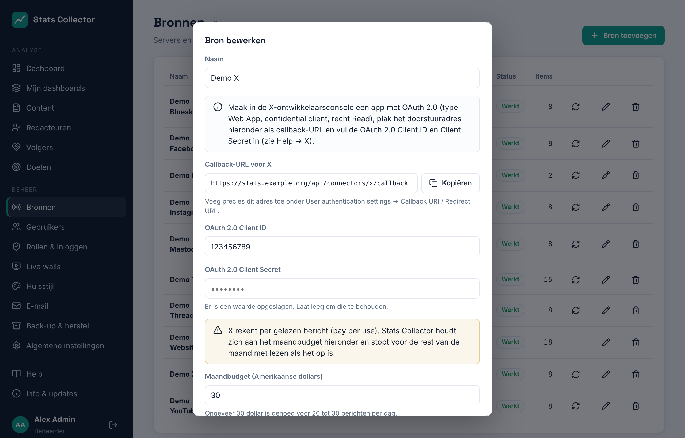

# X

Stats Collector leest de cijfers van een **X**-account (voorheen Twitter) via de X API v2. Elk X-account is een eigen bron.

!!! warning "X rekent per bericht"
    De X API is **pay per use**: je koopt tegoed in de X-ontwikkelaarsconsole en betaalt voor elk bericht dat gelezen wordt (ongeveer $0,005 per bericht in 2026). Stats Collector heeft daarom per bron een **maandbudget** en stopt voor de rest van de maand met lezen als dat op is. Met de standaardinstellingen (elke 6 uur, budget $30) blijft een account dat 20 tot 30 keer per dag post binnen het budget.

## Wat wordt verzameld

| | Per dag voor het account | Per bericht |
| --- | --- | --- |
| X | Weergaven, likes, reposts, antwoorden, citaten, bladwijzers, linkkliks, profielkliks, nieuwe volgers (netto), volgers | Hetzelfde als per dag |

Goed om te weten:

- **X heeft geen bereik.** Weergaven tellen mee voor *weergaven*; likes, reposts, antwoorden, citaten en bladwijzers voor *interacties*.
- Linkkliks en profielkliks krijg je alleen voor berichten van de **laatste 30 dagen**.
- Per dag is wat de berichten die dag erbij kregen; een bericht dat nieuw is voor Stats Collector krijgt zijn hele totaal op de dag dat het verscheen.
- **Nieuwe volgers (netto)** is de verandering van het aantal volgers van de ene dag op de andere. Het aantal volgers per dag begint op de dag dat je verbindt.
- Berichten van de laatste 24 uur worden elke **6 uur** gelezen (instelbaar), berichten van de laatste 7 dagen één keer per dag zolang minder dan 80% van het budget gebruikt is. Direct na het verbinden worden eenmalig tot 200 oudere berichten gelezen (ongeveer $1). Reposts en antwoorden tellen niet mee.
- X werkt hier in hele dagen: in de weergave **24 uur** van het dashboard toont het *alleen dagcijfers*.
- Links in een bericht koppelen het aan het websiteartikel waarnaar het verwijst (zie [Content](content.md)).

## 1. De app maken in de X-ontwikkelaarsconsole

1. Log in op [console.x.com](https://console.x.com) met het X-account van de organisatie en koop wat **tegoed** (pay per use).
2. Maak een **project** en daarin een **app**.
3. Open in de app **User authentication settings → Set up**:
    - **App permissions**: *Read*;
    - **Type of App**: *Web App, Automated App or Bot* (een confidential client);
    - **Callback URI / Redirect URL**: het adres dat Stats Collector in het bronformulier toont (het eindigt op `/api/connectors/x/callback`);
    - **Website URL**: het adres van Stats Collector.
4. Sla op. Kopieer onder **Keys and tokens** de **OAuth 2.0 Client ID** en het **Client Secret** (niet de API Key en Secret van OAuth 1.0a).

## 2. De bron toevoegen in Stats Collector

1. **Beheer → Bronnen → Bron toevoegen**, soort **X (account)**.
2. Vul een naam, de **OAuth 2.0 Client ID** en het **Client Secret** in.
3. Stel het **maandbudget** in, hoe vaak er gelezen wordt (**Lezen elke … uur**) en, als X de prijzen verandert, de **prijs per gelezen bericht**. Sla op.

    

4. Klik op **Verbinden met X** en log in met het X-account. Geef toegang.
5. Terug in Stats Collector is het account verbonden en worden de eerste berichten op de achtergrond gelezen.

Het formulier toont hoeveel van het budget deze maand gebruikt is (een schatting; de echte kosten staan in de X-ontwikkelaarsconsole). Is het budget op, dan staat bij de bron *Het maandbudget voor X is op* en wordt er vanaf de eerste van de volgende maand weer gelezen, of zodra je het budget verhoogt.

De toegang blijft geldig zolang de bron synchroniseert: X geeft bij elke synchronisatie een nieuw vernieuwingstoken. Staat bij de bron *De toegang tot X is verlopen*, klik dan opnieuw op **Verbinden met X**. **Ontkoppelen** vergeet de tokens; de cijfers die al verzameld zijn blijven bewaard.
