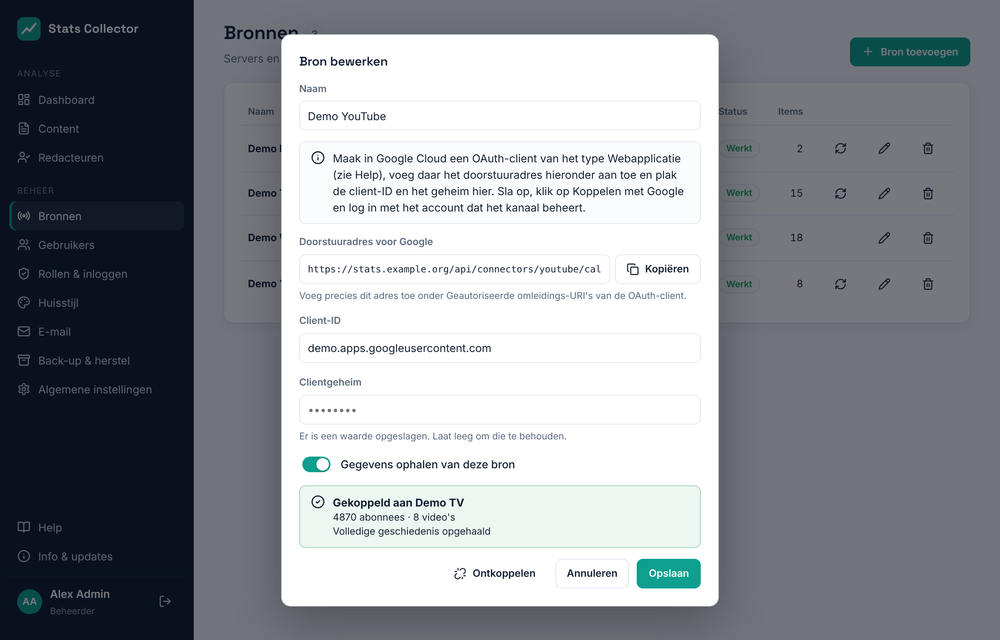

# YouTube

Stats Collector leest je YouTube-kanaal uit met de **YouTube Data API v3** (video's, aantal abonnees) en de **YouTube Analytics API** (weergaven, kijktijd, likes, reacties, keren gedeeld, abonnees erbij en eraf). Na het koppelen haalt hij de **volledige geschiedenis van het kanaal** op, terug tot de dag waarop het is aangemaakt, en daarna houdt hij die elke drie uur bij.

## Wat je krijgt

| Cijfer | Per | Opmerking |
| --- | --- | --- |
| Weergaven, kijktijd, gemiddelde kijkduur | Kanaal en video, per dag | Gemiddelde kijkduur = kijktijd ÷ weergaven |
| Likes, reacties, keren gedeeld | Kanaal en video, per dag | |
| Abonnees erbij en eraf | Kanaal, per dag | |
| Abonnees | Kanaal, per dag | Zie hieronder |

- YouTube Analytics geeft cijfers **per dag**, niet per uur, en ze komen **een tot twee dagen later** binnen. Vandaag en gisteren vullen zich dus later aan; Stats Collector leest bij elke ronde de laatste vijf dagen opnieuw.
- Per video worden de 200 best bekeken video's van elke dag bewaard. Voor een regionaal kanaal zijn dat alle video's die die dag bekeken zijn.
- **Abonnees per dag**: YouTube geeft alleen het aantal van vandaag. Stats Collector rekent de eerdere dagen terug met de dagelijkse aanmeldingen en afmeldingen, dus de geschiedenis is een goede benadering (YouTube haalt af en toe spamabonnees weg, en dat zie je niet in de dagcijfers).
- Video's die verwijderd of privé gemaakt zijn houden hun cijfers; ze tonen dan hun video-ID in plaats van de titel.

De cijfers staan op het **Dashboard** (kaart *Website en video*) en op de pagina **Content**, waar elke video een item is. Zie [Content en redacteuren](content.md).

## 1. Google Cloud-project

1. Open [console.cloud.google.com](https://console.cloud.google.com) met het Google-account dat eigenaar of beheerder van het YouTube-kanaal is → **Nieuw project**, bijvoorbeeld *Stats Collector*.
2. **API's en services → Bibliotheek**: zet **YouTube Data API v3** en **YouTube Analytics API** aan.

## 2. OAuth-toestemmingsscherm

1. **API's en services → OAuth-toestemmingsscherm** (in nieuwere consoles: **Google Auth Platform → Branding / Doelgroep**). Gebruikerstype **Extern**, tenzij het kanaal bij je eigen Google Workspace hoort; dan heeft **Intern** geen verificatie nodig.
2. Appnaam *Stats Collector*, supportadres, homepage (`https://stats.example.org`), URL van het privacybeleid en geautoriseerd domein (`example.org`).
3. Scopes (**Gegevenstoegang**): `https://www.googleapis.com/auth/youtube.readonly` en `https://www.googleapis.com/auth/yt-analytics.readonly`.
4. Zolang de app op **Testen** staat, voeg je het Google-account dat het kanaal beheert toe als **testgebruiker**. In testmodus beëindigt Google de toegang na **7 dagen**; Stats Collector meldt dan *De toegang tot YouTube is verlopen* en je koppelt opnieuw. Publiceer de app (**Doelgroep → App publiceren**) en rond de verificatie van Google af om dat te voorkomen.

## 3. OAuth-client

1. Ga in Stats Collector naar **Beheer → Bronnen → Bron toevoegen**, kies **YouTube (kanaal)** en kopieer het **doorstuuradres voor Google** uit het venster. Dat is `https://<adres van je Stats Collector>/api/connectors/youtube/callback`.
2. In Google Cloud: **API's en services → Inloggegevens → Inloggegevens maken → OAuth-client-ID**, type **Webapplicatie**. Plak het doorstuuradres onder **Geautoriseerde omleidings-URI's**. Klik op **Maken** en kopieer de **client-ID** en het **clientgeheim**.

## 4. Het kanaal koppelen

1. Plak in Stats Collector de client-ID en het clientgeheim, geef de bron een naam en klik op **Opslaan**.
2. Klik op **Koppelen met Google**. Log in met het account dat het kanaal beheert. Staat het kanaal op een merkaccount, kies dan dat merkaccount als Google vraagt welk kanaal of account je wilt gebruiken. Geef beide rechten.
3. Je komt terug bij Bronnen met *YouTube-kanaal gekoppeld*. Het venster toont het kanaal, de abonnees en video's, en hoe ver het ophalen van de geschiedenis is.

De geschiedenis wordt opgehaald in stappen van ongeveer 120 dagen per kwartier, dus een kanaal van tien jaar oud is in ongeveer acht uur compleet. De kanaaltotalen per dag zijn er meteen.

## Ontkoppelen

**Ontkoppelen** in het venster trekt de toegang bij Google in en stopt het ophalen. De cijfers die al zijn opgehaald blijven bewaard. Wil je nog een kanaal koppelen met dezelfde Google-app, voeg dan een nieuwe YouTube-bron toe met dezelfde client-ID en hetzelfde geheim.

## Problemen

| Melding | Oplossing |
| --- | --- |
| *Google accepteerde de code niet* | Het clientgeheim klopt niet, of het doorstuuradres in Google Cloud is niet precies het adres uit Stats Collector (controleer `https`, de hostnaam en dat er geen schuine streep aan het eind staat). |
| *Niet alle rechten zijn gegeven* | Koppel opnieuw en vink op het scherm van Google beide vakjes aan. |
| *Dit Google-account heeft geen YouTube-kanaal* | Log in met het account (of merkaccount) van het kanaal. |
| *De toegang tot YouTube is verlopen* | Koppel opnieuw. In testmodus gebeurt dit elke 7 dagen; publiceer de app om dat te stoppen. |
| *YouTube weigerde de toegang* | Zet beide API's aan in het Google Cloud-project. |
| *Het dagelijkse YouTube-quotum is op* | Het ophalen gaat de volgende dag verder. De Data API staat 10.000 eenheden per dag toe; Stats Collector gebruikt er normaal een paar honderd. |
| *Het inloggen bij Google duurde te lang* | Begin opnieuw met **Koppelen met Google** en rond het binnen 10 minuten af. |
